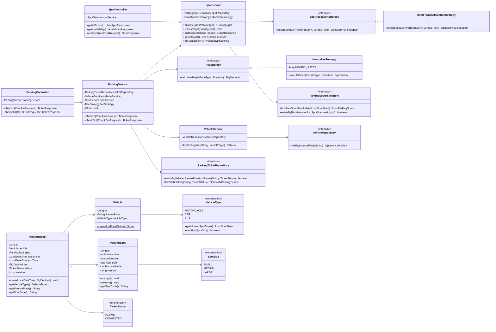

# Class Model

## Layers

```
controller  →  service  →  strategy (interfaces)
                  ↓
              repository  →  database
entity / dto are shared data classes
```

## Full Class Diagram



## Class Responsibilities

| Class | Layer | Responsibility |
|---|---|---|
| `ParkingController` | controller | HTTP endpoints for check-in / check-out |
| `SpotController` | controller | HTTP endpoints for spots and availability |
| `ParkingService` | service | Check-in / check-out flow and transaction |
| `SpotService` | service | Allocate, release, add spots; build availability |
| `VehicleService` | service | Find or register a vehicle |
| `SpotAllocationStrategy` | strategy | Contract: pick one spot from free spots |
| `BestFitSpotAllocationStrategy` | strategy | Smallest fit → lowest floor → lowest number |
| `FeeStrategy` | strategy | Contract: fee for a type and duration |
| `HourlyFeeStrategy` | strategy | Hourly rate per type, started hour charged, min 1 hour |
| `*Repository` | repository | DB access through Spring Data JPA |
| `Vehicle` | entity | A vehicle identified by plate |
| `ParkingSpot` | entity | One spot on one floor; knows if it is free |
| `ParkingTicket` | entity | One visit: vehicle + spot + times + fee |
| `VehicleType` | entity (enum) | Which spot sizes a vehicle fits in |
| `GlobalExceptionHandler` | exception | Converts exceptions into JSON errors |
| `ClockConfig` | config | Provides `Clock` bean (testable time) |
| `DataLoader` | config | Seeds 3 floors of sample spots |

## DTOs

| DTO | Used for |
|---|---|
| `CheckInRequest` | `licensePlate`, `vehicleType` |
| `CheckOutRequest` | `licensePlate` |
| `AddSpotRequest` | `floorNumber`, `spotNumber`, `size` |
| `TicketResponse` | ticket details returned on check-in / check-out |
| `SpotResponse` | one spot with status |
| `AvailabilityResponse` | total, free, free per floor per size |
| `ErrorResponse` | `status`, `message`, `timestamp` |

## Exceptions

| Exception | HTTP |
|---|---|
| `ResourceNotFoundException` | 404 |
| `InvalidRequestException` | 400 |
| `ParkingFullException` | 409 |
| Lock / constraint clash (Spring) | 409 |
