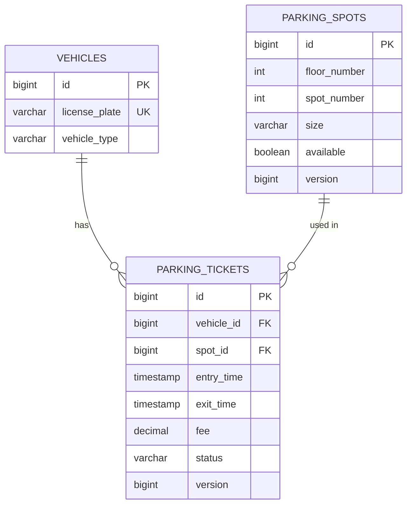
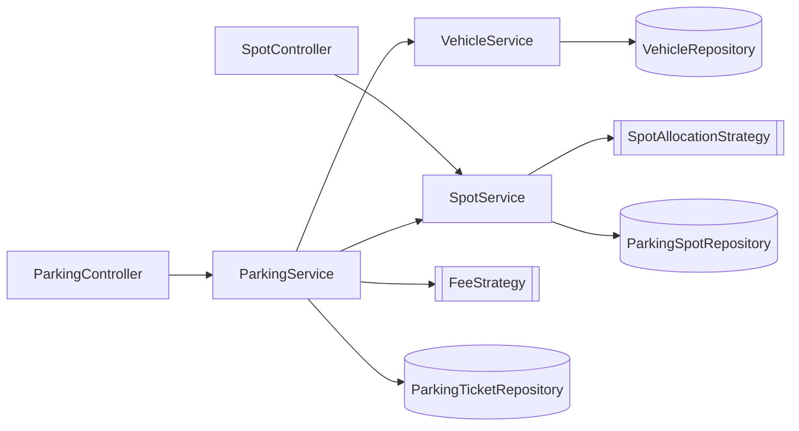
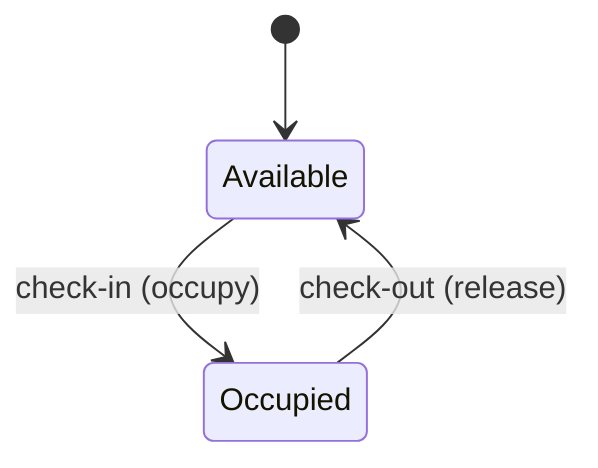
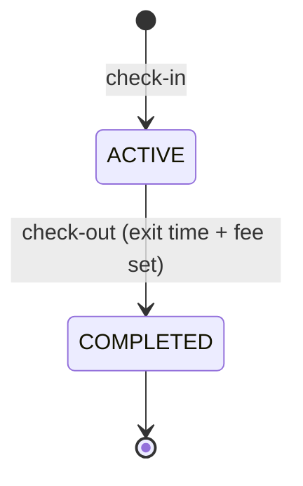
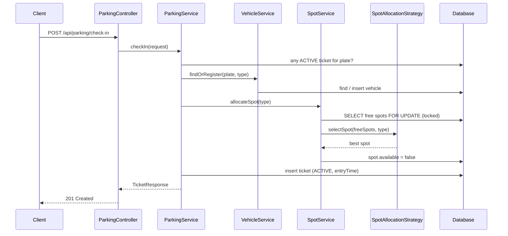
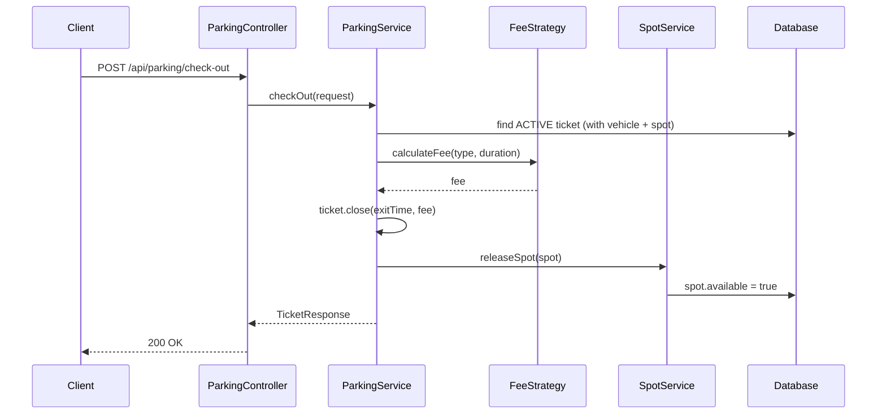

# Object Relationships

## 1. Entity Relationships (ER)

| Relationship | Multiplicity | JPA mapping | Meaning |
|---|---|---|---|
| Ticket → Vehicle | many to one | `@ManyToOne(fetch = LAZY)` | A vehicle has many tickets over time, **only one ACTIVE** |
| Ticket → Spot | many to one | `@ManyToOne(fetch = LAZY)` | A spot has many tickets over time, **only one ACTIVE** |
| Spot (floor, number) | unique | `@UniqueConstraint(floor_number, spot_number)` | No two spots with same number on a floor |
| Vehicle plate | unique | `@Column(unique = true)` | One row per vehicle |

The relationships are one-directional (ticket knows vehicle and spot, not the other way). That keeps entities simple and avoids loading big collections.

## 2. Kinds of Relationships Between Classes

| Type | Example | Why |
|---|---|---|
| **Association** | `ParkingTicket` → `Vehicle`, `ParkingSpot` | Ticket links one vehicle to one spot for one visit |
| **Dependency (injected)** | `ParkingService` → `SpotService`, `VehicleService`, `FeeStrategy`, `Clock` | Constructor injection, Spring creates them |
| **Realization** | `HourlyFeeStrategy` implements `FeeStrategy`; `BestFitSpotAllocationStrategy` implements `SpotAllocationStrategy` | Pluggable rules |
| **Inheritance** | Repositories extend `JpaRepository`; exceptions extend `RuntimeException` | Reuse framework behaviour |
| **Uses (value)** | `Vehicle` uses `VehicleType`; `ParkingSpot` uses `SpotSize` | Enum value, no own table |

## 3. Who Talks to Whom

- Controllers only call services.
- Only the service that owns an entity uses its repository (`SpotService` → spots, `VehicleService` → vehicles).
- Strategies have no dependencies – they get data as parameters and return a result.

## 4. State Changes

**ParkingSpot**

**ParkingTicket**

## 5. Check-in Sequence

## 6. Check-out Sequence

Both flows run in a single transaction, so either everything is saved or nothing is.
